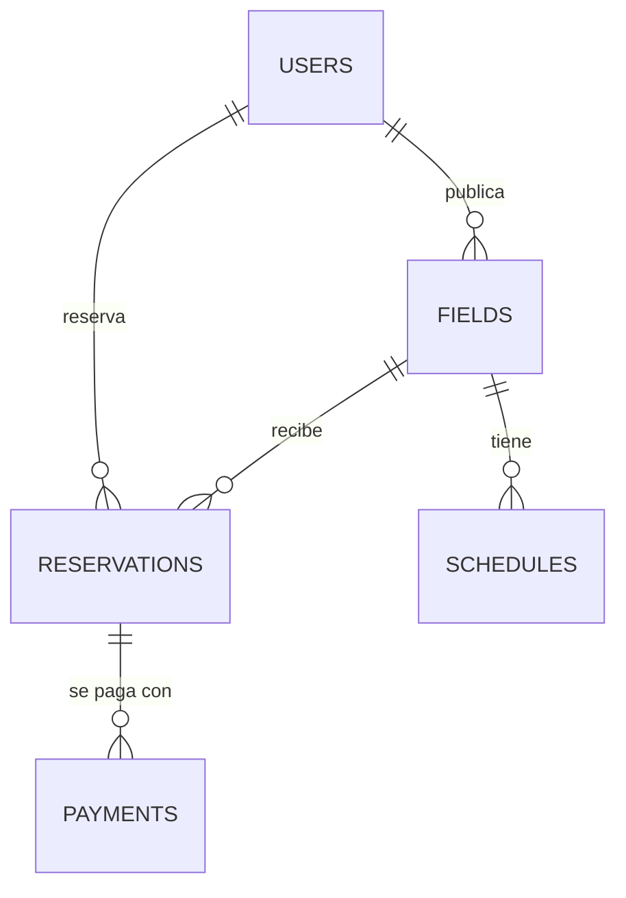

# CanchaYa Pasto — Base de datos

Base de datos **PostgreSQL** de CanchaYa Pasto, la plataforma para reservar canchas sintéticas en Pasto. Es la que usa el [backend en Spring Boot](https://github.com/walterjojoa/BACKEND-CANCHAS-YA) y está pensada para desplegarse en **Neon**.

> Los nombres de tablas, columnas y el código SQL están en inglés, igual que el backend. La documentación está en español.

## Contenido

```
├── migrations/      Esquema en orden (V01 … V15): tablas, restricciones, triggers, vistas, funciones
├── seeds/           Datos de prueba: usuarios, 4 canchas de Pasto, horarios, reservas y pagos
├── tests/           Pruebas de las reglas de negocio en SQL
├── queries/         Consultas de reportes para el dueño y el administrador
├── docs/            Modelo entidad-relación, diccionario de datos, conexión con el backend
├── docker/          Script de arranque del contenedor
├── install.sql      Instala todo (esquema + datos de prueba)
├── uninstall.sql    Borra todo
└── docker-compose.yml
```

## Modelo



| Tabla | Qué guarda |
|---|---|
| `users` | Jugadores (`PLAYER`), dueños de canchas (`OWNER`) y administradores (`ADMIN`) |
| `fields` | Canchas: nombre, dirección, coordenadas, precio por hora, dueño |
| `schedules` | Horario de cada cancha por día de la semana |
| `reservations` | Reservas por horas enteras, con valor total, anticipo y estado |
| `payments` | Intentos de pago del anticipo (Wompi, Nequi, Daviplata) |

Diagrama completo con columnas y estados: [docs/modelo-entidad-relacion.md](docs/modelo-entidad-relacion.md) · Detalle de cada columna: [docs/diccionario-de-datos.md](docs/diccionario-de-datos.md)

## Reglas que garantiza la base de datos

| Regla | Cómo |
|---|---|
| Nunca dos reservas cruzadas en la misma cancha | Restricción `EXCLUDE USING gist` sobre `(field_id, date, int4range(start_hour, end_hour))`, ignorando las canceladas |
| La reserva debe estar dentro del horario de la cancha y la cancha activa | Trigger `trg_reservations_within_schedule` |
| El pago debe ser igual al anticipo y no se puede pagar una reserva cancelada | Trigger `trg_payments_apply` |
| Un pago aprobado confirma la reserva automáticamente | Trigger `trg_payments_apply` |
| Nunca se cobra dos veces la misma reserva | Índice único parcial `uq_payments_one_approved` |
| Horas entre 0 y 24, montos positivos, anticipo ≤ total, roles y estados válidos | Restricciones `CHECK` |
| Correos únicos y en minúsculas | `UNIQUE` + `CHECK` |

## Instalación

### Opción 1 — Docker (local)

```bash
docker compose up -d
```

Crea PostgreSQL 16 en `localhost:5432` (base `canchaya`, usuario `canchaya`, contraseña `canchaya`), instala el esquema, carga los datos de prueba y corre las pruebas.

### Opción 2 — Neon o cualquier PostgreSQL

```bash
psql "postgresql://<usuario>:<contraseña>@<host>/<base>?sslmode=require" -f install.sql
```

Se ejecuta sobre una base **vacía**. Si no quieres los datos de prueba, comenta el bloque *Demo data* al final de `install.sql`.

En Neon también puedes pegar los archivos de `migrations/` en orden en el *SQL Editor* (y luego los de `seeds/`).

### Probar las reglas

```bash
psql "<conexión>" -f tests/test_business_rules.sql
```

Corre 13 pruebas (reservas cruzadas, horarios, cancha inactiva, pagos dobles, montos, correos, horas libres…) dentro de una transacción que se deshace al final, así que no modifica los datos.

### Desinstalar

```bash
psql "<conexión>" -f uninstall.sql
```

## Datos de prueba

Todos los usuarios tienen la contraseña **`canchaya123`** (hash BCrypt compatible con el backend):

| Correo | Rol |
|---|---|
| `owner@canchaya.co` | OWNER — Sintética El Ejido, La Bombonera Pasto |
| `owner2@canchaya.co` | OWNER — Cancha Torobajo, Fútbol 5 Pandiaco |
| `player@canchaya.co`, `laura@canchaya.co`, `mateo@canchaya.co` | PLAYER |
| `admin@canchaya.co` | ADMIN |

Las reservas de prueba usan fechas relativas a `CURRENT_DATE` (pasadas y futuras), con pagos aprobados, uno rechazado y una reserva cancelada.

## Vistas y funciones

| Objeto | Ejemplo |
|---|---|
| `fn_available_slots(field_id, date)` | `SELECT * FROM fn_available_slots(1, CURRENT_DATE + 2);` |
| `v_reservation_detail` | `SELECT * FROM v_reservation_detail WHERE status = 'CONFIRMED';` |
| `v_owner_monthly_income` | `SELECT * FROM v_owner_monthly_income ORDER BY month DESC;` |
| `v_field_daily_occupancy` | `SELECT * FROM v_field_daily_occupancy WHERE date = CURRENT_DATE;` |

Más consultas (horas pico, canchas más reservadas, tasa de cancelación…) en [queries/reports.sql](queries/reports.sql).

## Conexión con el backend

Ver [docs/conexion-backend.md](docs/conexion-backend.md): variables de entorno, correspondencia entidad ↔ tabla y qué regla valida cada capa.

## Convenciones

- Tablas en plural y `snake_case`, igual que la estrategia de nombres de Hibernate.
- Prefijos: `fk_`/`uq_`/`ck_`/`ex_` para restricciones, `ix_` para índices, `trg_` triggers, `fn_` funciones, `v_` vistas.
- Las migraciones siguen el formato de Flyway (`V01__descripcion.sql`), por si el backend adopta Flyway más adelante.
- Los estados y roles se guardan como texto con `CHECK` (no como `ENUM` de PostgreSQL) para que coincidan con `@Enumerated(EnumType.STRING)` de JPA.
