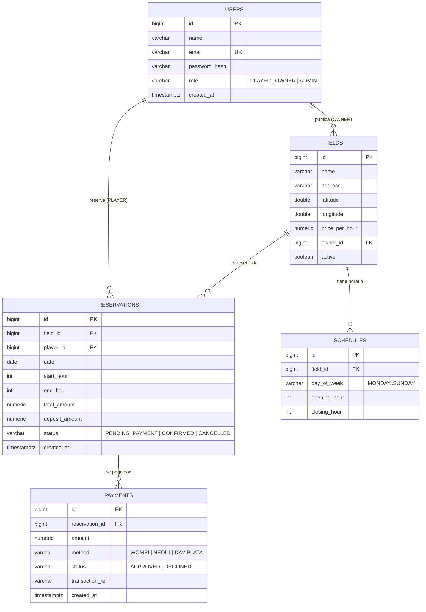
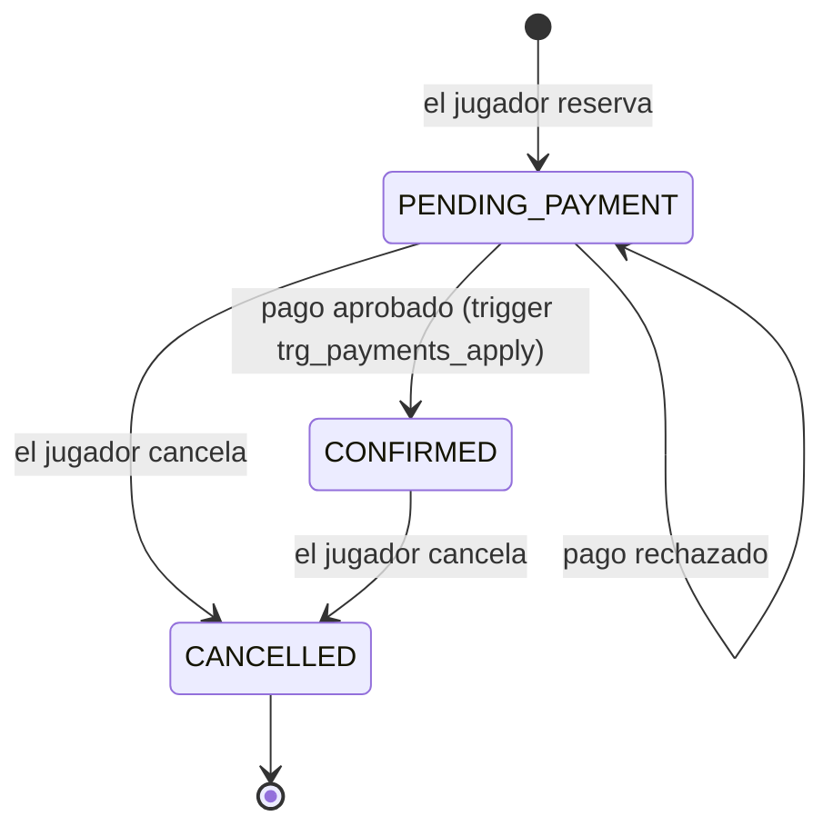

# Modelo entidad-relación

GitHub dibuja este diagrama automáticamente (Mermaid).

## Cardinalidades

| Relación | Cardinalidad | Explicación |
|---|---|---|
| users → fields | 1 : N | Un dueño (OWNER) publica muchas canchas; cada cancha tiene un solo dueño |
| users → reservations | 1 : N | Un jugador hace muchas reservas; cada reserva es de un jugador |
| fields → schedules | 1 : 0..7 | Una cancha tiene como máximo un horario por día de la semana |
| fields → reservations | 1 : N | Una cancha recibe muchas reservas |
| reservations → payments | 1 : N | Una reserva puede tener varios intentos de pago, pero **solo uno aprobado** |

## Estados de una reserva

